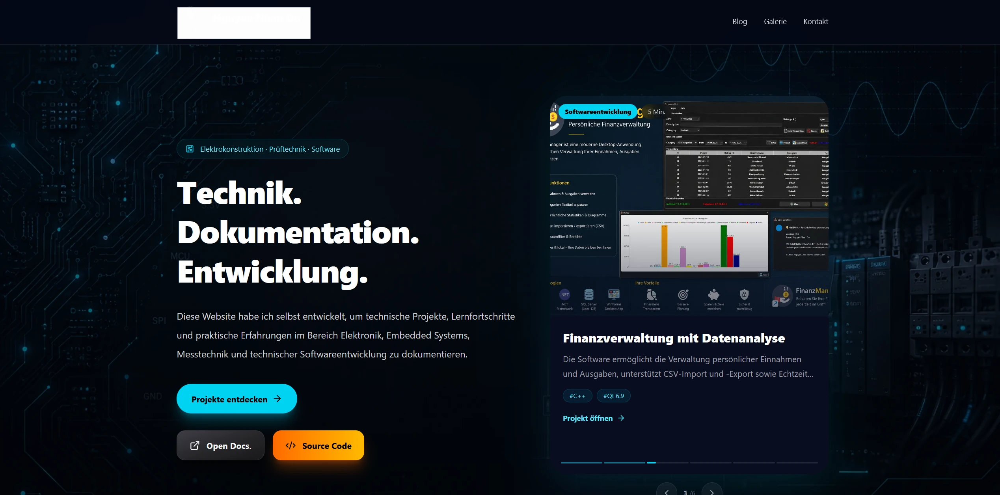
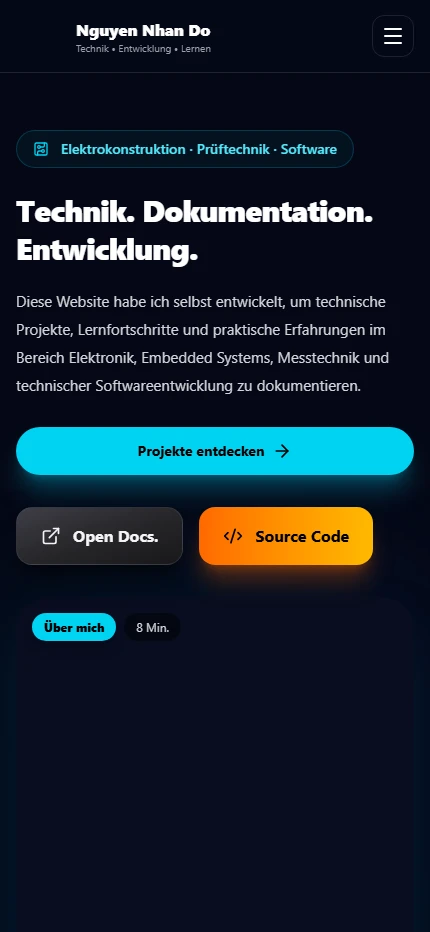
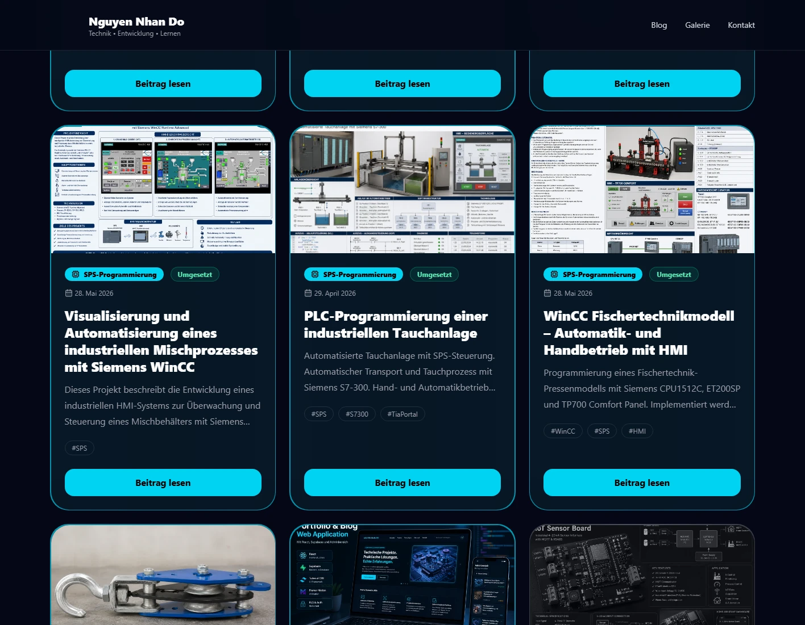
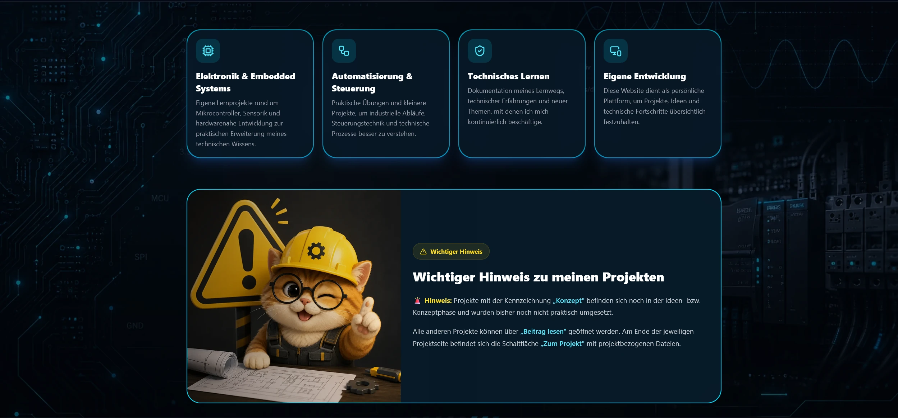
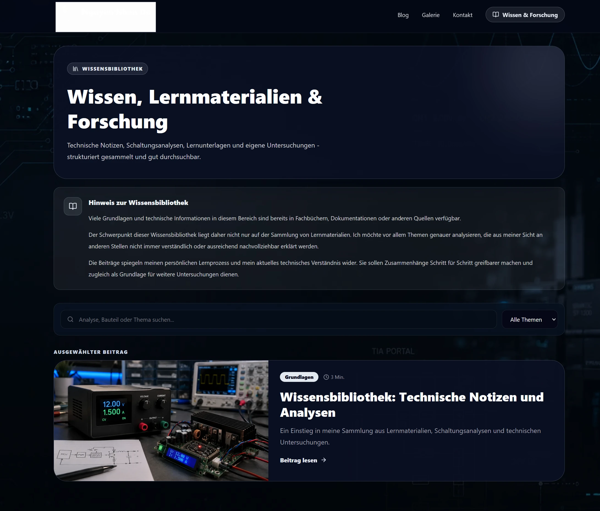
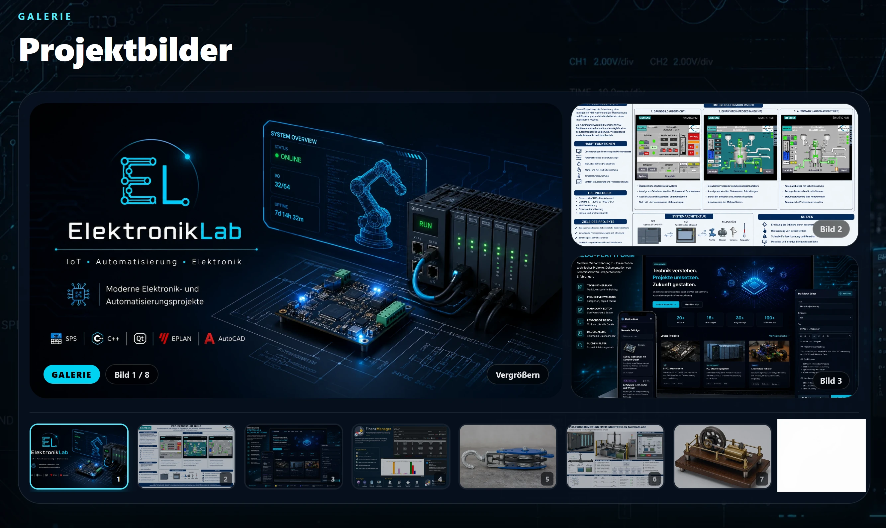
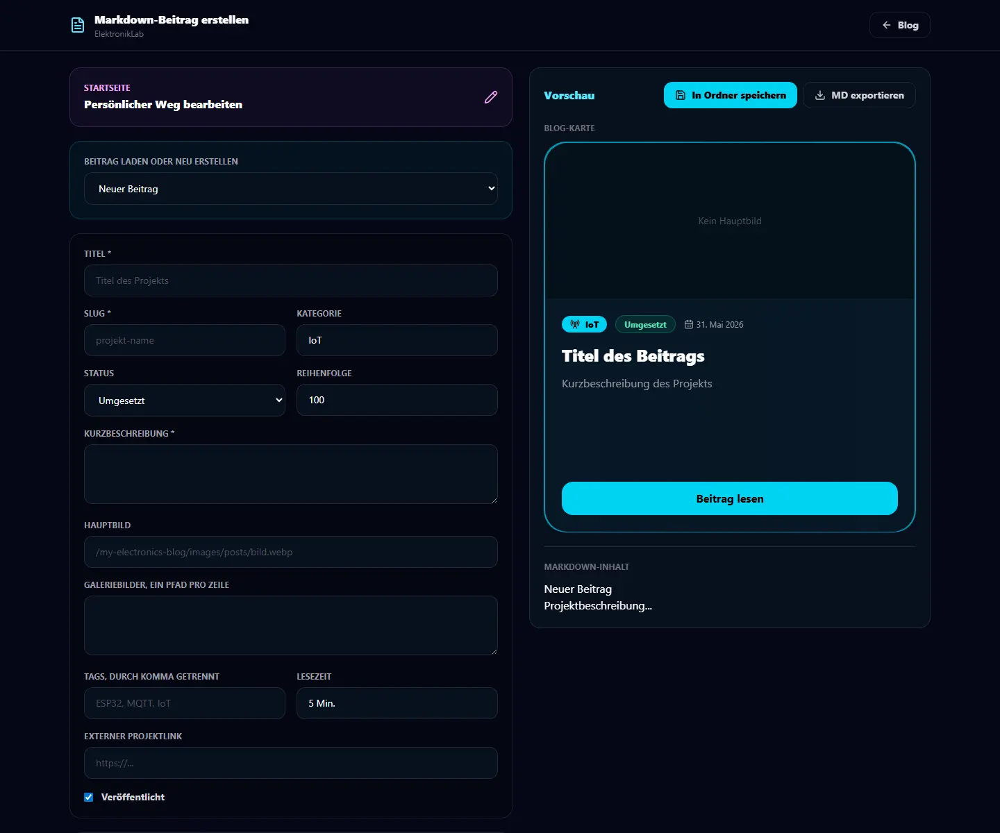

# ElektronikLab

Personal portfolio and technical blog for electronics, automation, embedded systems and engineering projects.

[](https://nguyennhando.github.io/my-electronics-blog/)



## Overview

ElektronikLab documents practical projects, technical concepts and learning progress in areas such as electronics, measurement technology, industrial automation and software development. A dedicated knowledge library collects technical notes, learning material, circuit analyses and personal research.

The website is built as a static React application and deployed through GitHub Pages. Blog posts, knowledge articles and editable homepage content are stored as Markdown files and loaded at build time.

## Responsive Design

| Desktop homepage | Mobile homepage |
| --- | --- |
|  |  |

## Website Sections

| Blog with search and filters | Feature cards and project notice |
| --- | --- |
|  |  |

| Knowledge library | Free-form project gallery |
| --- | --- |
|  |  |

## Local Content Editor



## Features

- Responsive portfolio and technical blog
- Multilingual Markdown-based project articles with German fallback
- Dedicated knowledge library for technical notes, learning material and research articles
- Categories, tags, search and project status filters
- Project image galleries and external project links
- Editable free-form homepage gallery with split showcase, thumbnails and lightbox
- Editable homepage card for the personal journey section
- Local-only Markdown editor for creating and updating projects, knowledge articles and homepage content
- Content Security Policy for the production website

## Tech Stack

- React
- Vite
- Tailwind CSS
- Framer Motion
- React Markdown
- Lucide React
- GitHub Pages

## Getting Started

Install the dependencies and start the development server:

```bash
npm install
npm run dev
```

Create a production build:

```bash
npm run build
```

## Content Management

Blog posts, knowledge articles and localized homepage content are stored in `src/content/de/`, `src/content/en/` and `src/content/vi/`. Article images are stored in `public/images/posts/`. Free-form gallery images are stored separately in `public/images/galerie/`.

Open [the admin editor](https://nguyennhando.github.io/my-electronics-blog/?admin=1) and sign in with GitHub as `nguyennhando`. Under **Settings → Set blog password**, you can set or change the password for the separate blog account. That account also uses the username `nguyennhando` and works in another browser or on another device. Changing its password expires sessions created with the previous password.

Create or select a post, edit it in the Markdown preview, and select **Publish**. The editor commits the selected changes through the GitHub App and displays the progress of the GitHub Pages deployment. The homepage content and personal journey editors store localized files such as `src/content/de/home-content.md` and `src/content/de/personal-way.md`.

Use `Reihenfolge der Projektkarten bearbeiten` to reorder blog cards visually. Saving the order updates the `sort_order` value consistently across all available language versions.

Use `Website-Hintergrund bearbeiten` to update the optional website background image. Its path is stored in `src/content/site-settings.md`. Leave the field empty to keep the default gradient background.

Use `Projektgalerie bearbeiten` to manage the free-form homepage gallery. Add one image path per line in the desired order. Gallery images are stored in `public/images/galerie/`, and the image list is stored in `src/content/gallery-settings.md`.

### Admin service deployment

1. Deploy the Cloudflare Worker with `wrangler deploy --config admin-worker/wrangler.toml`.
2. Create a private GitHub App with the Worker URL followed by `/auth/github/callback` as its redirect URI. Set the repository permission **Contents** to **Read and write**, disable webhooks, and install the app on `nguyennhando/my-electronics-blog`.
3. Set the Worker secrets `GITHUB_CLIENT_ID`, `GITHUB_CLIENT_SECRET`, `GITHUB_PRIVATE_KEY` (the GitHub App PEM), `GITHUB_INSTALLATION_ID`, and `SESSION_KEY` (a random 32-byte key encoded as base64url).
4. Set the GitHub Actions repository variable `VITE_ADMIN_ORIGIN` to the HTTPS Worker origin, then run the GitHub Pages deployment. To open admin from a local Vite preview, set the same variable in `.env.local` before running `npm run admin`.

The GitHub App's installation token is held by the Worker and restricted to the blog repository. The Worker serves the admin page on its own origin so its session cookie works without third-party cookies.

## Markdown Format

Each blog post starts with frontmatter:

```md
---
id: esp32-mqtt-gateway
slug: esp32-mqtt-gateway
translation_id: esp32-mqtt-gateway
language: de
content_type: project
title: ESP32 als MQTT-Gateway
category: IoT
image_url: /my-electronics-blog/images/posts/ESP32-main.webp
image_gallery:
- /my-electronics-blog/images/posts/detail-1.webp
tags:
- ESP32
- MQTT
read_time: 5 Min.
published: true
created_at: '2026-05-30T10:00:00.000Z'
external_link: ''
project_status: done
sort_order: 100
---

# ESP32 als MQTT-Gateway

Post content...
```

Supported `project_status` values:

- `idea`
- `in_progress`
- `done`

Lower `sort_order` values appear first.

Use `content_type: knowledge` for articles that should appear in the `Wissen & Forschung` library instead of the project blog.

## Multilingual Articles

Use one Markdown file per language and store translated files in the corresponding subfolder:

```text
src/content/de/esp32-mqtt-gateway.md
src/content/en/esp32-mqtt-gateway.md
src/content/vi/esp32-mqtt-gateway.md
```

All language versions of an article must use the same `translation_id`. The `slug`, title, excerpt and Markdown body can be translated independently:

```md
---
translation_id: esp32-mqtt-gateway
language: vi
slug: giam-sat-cam-bien-esp32-mqtt
title: Giám sát cảm biến bằng ESP32 và MQTT
---
```

If a translation is missing, the website displays the German article with a fallback notice.

## Project Structure

```text
docs/
  github-images/      Images used only by the GitHub README
public/
  images/
    galerie/          Free-form homepage gallery images
    posts/            Blog and knowledge article images
src/
  components/         Shared UI components
  content/            Markdown content and shared settings
    de/               German posts and homepage content
    en/               English posts and homepage content
    vi/               Vietnamese posts and homepage content
    gallery-settings.md
    site-settings.md
  lib/posts.js        Markdown loading and frontmatter parsing
  App.jsx             Application UI
  index.css           Tailwind CSS entrypoint
  main.jsx            React entrypoint
```

To update the GitHub repository preview without changing the website, replace the image files in `docs/github-images/` and keep their filenames unchanged.

Image naming convention:

- `website-home-desktop.webp`: desktop homepage screenshot and README cover
- `website-home-mobile.webp`: mobile homepage screenshot
- `website-blog-section.webp`: blog cards, search and category filter
- `website-features-section.webp`: feature cards and project notice
- `website-editor-local.webp`: local Markdown editor screenshot
- `wissen&forschung.webp`: knowledge library screenshot
- `projektbilder.webp`: free-form project gallery screenshot

## Deployment

Deploy the production build to GitHub Pages:

```bash
npm run deploy
```

The Vite base path is configured for:

```text
/my-electronics-blog/
```

## Security Notes

- GitHub Pages serves the public website. The Worker authenticates the editor and limits writes to the blog's content and asset directories.
- A Content Security Policy is defined in `index.html`.
- Published images are stripped of metadata before deployment.
- Never commit credentials, API keys, private documents or environment files.
